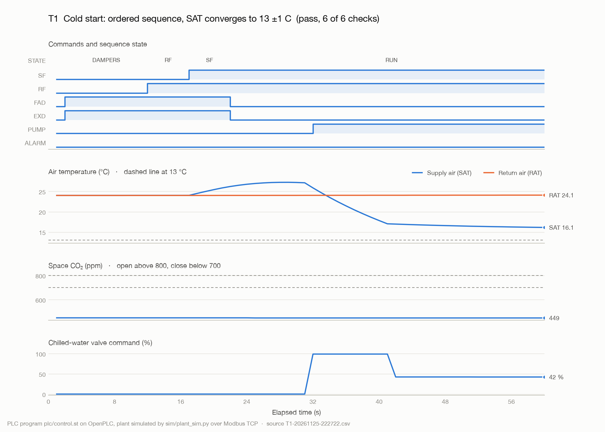
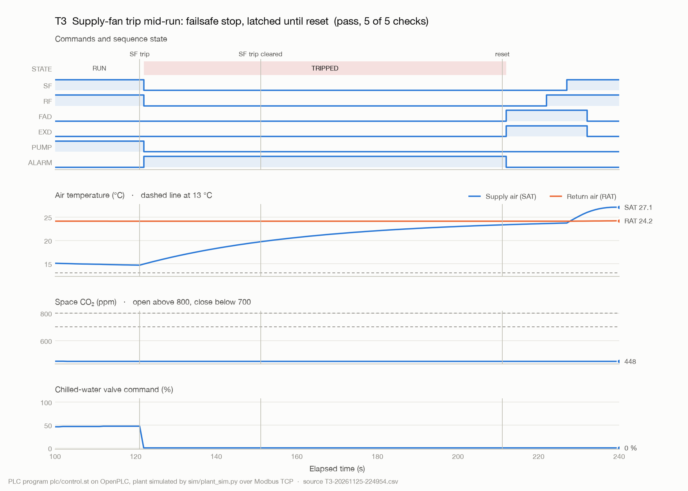
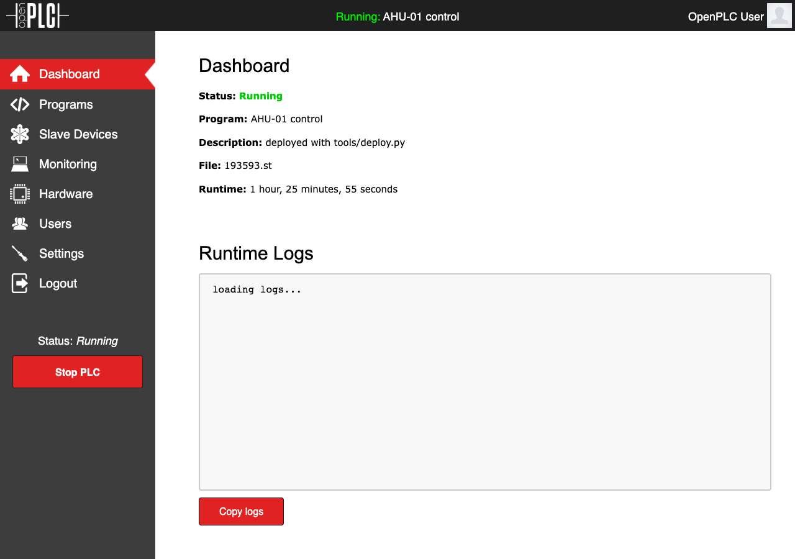
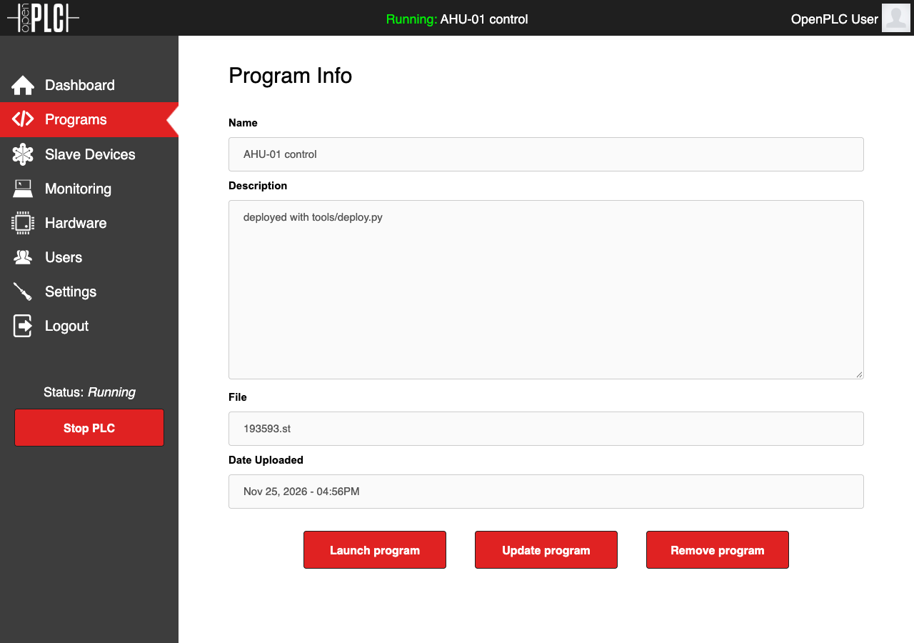

# AHU-01 · Air-handling unit control on OpenPLC

I built this self-taught controls project around a simulated air-handling unit. An IEC 61131-3 Structured Text program runs on OpenPLC and controls two fans, two dampers, a chilled-water valve and a pump. A Python model reads the actuator commands over Modbus TCP, advances the simulated plant by one second and returns sensor readings to the PLC. All measurements below come from that closed loop.



## How the unit operates

| Condition | Controller response |
|---|---|
| Occupied schedule, Auto selected, interlocks healthy | Command both dampers open for 10 s, run the return fan for 5 s, then start the supply fan. After a further 5 s, supply-fan feedback permits RUN. The first two delays are timer-based. |
| Supply air warmer than 13 °C | In RUN, a direct-acting PI loop updates the chilled-water valve every 10 s. The proportional gain is 6 percentage points per kelvin and the integral time is 60 s. The valve spans 0–100%. The integral stops accumulating when the error would drive the valve further into saturation. Pump demand starts above 2% valve command. |
| Space CO₂ changes | In RUN the dampers open above 800 ppm and close below 700 ppm. A low outdoor-air signal inhibits a new opening command. The model admits 15% outdoor air at minimum and 90% at full travel. |
| Occupied schedule ends during RUN | The supply fan stops, the valve closes, the pump stops and the dampers go to minimum. The return fan runs for a 10 s purge before IDLE. Hand mode releases the automatic actuator commands. |
| Fan overload, open smoke or gas loop, or missing supply-fan feedback | The PLC drops the actuator commands and latches the first trip cause. A smoke trip also opens the exhaust damper after 10 s of fan spin-down. A reset edge with healthy interlocks permits a new start. |
| Filter pressure switch closes or differential pressure exceeds 250 Pa | The general alarm comes on and cooling continues. The alarm word also carries separate CO₂ and outdoor-air status bits. |

The PLC scans every 50 ms. The simulator samples at 1 Hz, reads outputs first and writes inputs last. For a fault scheduled at 120 s, row 121 records the injected input alongside the previous outputs. Row 122 is the first sample of the controller response.

## Modbus I/O

All addresses are zero-based, unit 1. The simulator writes the 15 input points together as a holding-register image. An analog count of 10000 represents the top of each span.

| Direction | Modbus addresses | Signals in address order |
|---|---|---|
| Plant → PLC, digital | Holding 1124–1128 | Supply-fan run feedback, supply-fan trip, return-fan trip, smoke loop healthy, gas loop healthy |
| Plant → PLC, digital | Holding 1129–1133 | High filter pressure switch, low outdoor-air lockout, Auto selector, occupied schedule, trip reset |
| Plant → PLC, analog | Holding 1134–1138 | Supply air (0–40 °C), return air (0–40 °C), outdoor air (0–50 °C), space CO₂ (0–2000 ppm), filter pressure (0–500 Pa) |
| PLC → plant, digital | Coils 0–5 | Supply fan, return fan, exhaust damper, fresh-air damper, general alarm, chilled-water pump |
| PLC → plant, analog and status | Holding 0–2 | Valve command (0–10000 counts), sequence state, alarm word |

The [address map](docs/address-map.md) lists individual tags, IEC locations, state codes and alarm bits.

## Closed-loop evidence

Each scenario produces a 1 Hz CSV, an event CSV and a JSON check summary. The event CSV records changes observed by the simulator. Times refer to samples in the trace.

| Scenario | Recorded result | Evidence |
|---|---|---|
| T1 · Cold start | **6/6 passed.** Dampers opened at 2 s, the return fan started at 12 s, the supply fan started at 17 s, and RUN began at 22 s. The largest supply-temperature error from 240–360 s was 0.43 °C. | [Checks](runs/T1-20261125-222722.json) · [Trace](runs/T1-20261125-222722.csv) · [Chart](docs/img/T1.png) |
| T2 · 100-person occupancy step | **7/7 passed.** The dampers reopened at 472 s and closed at 877 s. CO₂ peaked at 801 ppm and finished at 731 ppm. Supply temperature recovered to within 1 °C of setpoint 133 s after opening. | [Checks](runs/T2-20261125-223338.json) · [Trace](runs/T2-20261125-223338.csv) · [Chart](docs/img/T2.png) |
| T3 · Supply-fan trip | **5/5 passed.** At 122 s the actuator commands were off and the first-out alarm word was 1. Clearing the overload left the trip latched. After reset, the sequence restarted at 212 s and reached RUN at 232 s. | [Checks](runs/T3-20261125-224954.json) · [Trace](runs/T3-20261125-224954.csv) · [Chart](docs/img/T3.png) |
| T4 · Smoke interlock | **7/7 passed.** The smoke trip latched with alarm word 4 at 122 s. The exhaust command came on at 132 s with both fans off and fresh air closed. After reset, RUN resumed at 232 s. | [Checks](runs/T4-20261125-225509.json) · [Trace](runs/T4-20261125-225509.csv) · [Chart](docs/img/T4.png) |
| T5 · Filter clog | **4/4 passed.** The filter alarm appeared at 232 s with 252 Pa measured. The unit stayed in RUN. The largest supply-temperature error from 240–360 s was 0.43 °C. | [Checks](runs/T5-20261125-230054.json) · [Trace](runs/T5-20261125-230054.csv) · [Chart](docs/img/T5.png) |

T2 also shows the thermal effect of closing the dampers. With less hot outdoor air entering the coil, supply temperature fell and reached 11.4 °C at the end of the recording. The 133 s recovery measurement applies to the opening step.



Two test-harness corrections preceded this run. The trip checks now use the first output sample after input publication, and the event log uses the same timestamps as the sample CSV. T2 also runs for 960 s so the simulated zone has time to reach the damper closing threshold. The acceptance limits for supply temperature and CO₂ stayed the same.

An offline replay of all 2,310 samples reproduced the 29 results with two tighter timing checks. T3 and T4 require RUN after the reset pulse, and T4 checks both ends of the smoke-purge timing window. The recorded first-out state lasted until reset in both traces. [Suite log](runs/suite.log)

## OpenPLC runtime

The dashboard and program record show the same running upload after the suite. OpenPLC assigned the filename `193593.st` to the uploaded copy of `plc/control.st`.

| Dashboard | Program record |
|---|---|
|  |  |

## Reproduce a run

1. On a fresh machine with Docker running, start an OpenPLC container bound to loopback. If the project runtime already exists, use that instance. The web interface uses port 8080 and Modbus TCP uses port 502.

   ```sh
   docker run -d --name openplc \
     -p 127.0.0.1:8080:8080 -p 127.0.0.1:502:502 wzy318/openplc
   ```

2. From the project root, install the pinned dependencies in a Python 3.12 environment. The plant-model unit tests run offline.

   ```sh
   python3.12 -m venv .venv
   .venv/bin/python -m pip install -r requirements.txt
   .venv/bin/python -m unittest tests.test_physics -v
   ```

3. Wait for any background suite to exit and close any other Modbus client. Deploy the Structured Text source to the local web interface. Compilation stops the runtime and the deploy tool restarts it. It uses the image's default local login, or credentials supplied through `OPENPLC_USER` and `OPENPLC_PASSWORD`.

   ```sh
   if [ -f runs/suite.pid ]; then
     while kill -0 "$(cat runs/suite.pid)" 2>/dev/null; do sleep 10; done
   fi
   .venv/bin/python tools/deploy.py plc/control.st --name "AHU-01 control"
   ```

4. Run the suite with a single Modbus client. Allow about 40 minutes of wall time for all five scenarios. Each starts from a healthy input image with a reset pulse. The simulator returns the unit to IDLE between tests. To run only the cold start, use `--test T1`.

   ```sh
   .venv/bin/python -m sim.plant_sim --test all
   ```

5. Plot a completed sample CSV. The plotter reads the check summary beside the CSV. Add `--xlim 0 60` to inspect the startup sequence.

   ```sh
   .venv/bin/python tools/plot_run.py runs/T1-20261125-222722.csv docs/img/T1.png
   ```

## File map

| Path | Contents |
|---|---|
| [plc/control.st](plc/control.st) | PLC sequence, PI function block, trips and located I/O |
| [sim/physics.py](sim/physics.py) | Single-zone thermal, ventilation and filter model |
| [sim/plant_sim.py](sim/plant_sim.py) | Modbus exchange, timed inputs, CSV logging and scenario checks |
| [tests/test_physics.py](tests/test_physics.py) | Eight offline tests of the model |
| [tools/](tools/) | Deploy script, separate I/O mapping probe and CSV plotter |
| [docs/control-narrative.md](docs/control-narrative.md) | Original design and as-built notes |
| [docs/design-notes.md](docs/design-notes.md) | Model assumptions, equations and time constants |
| [runs/](runs/) and [docs/img/](docs/img/) | Test evidence and figures |
